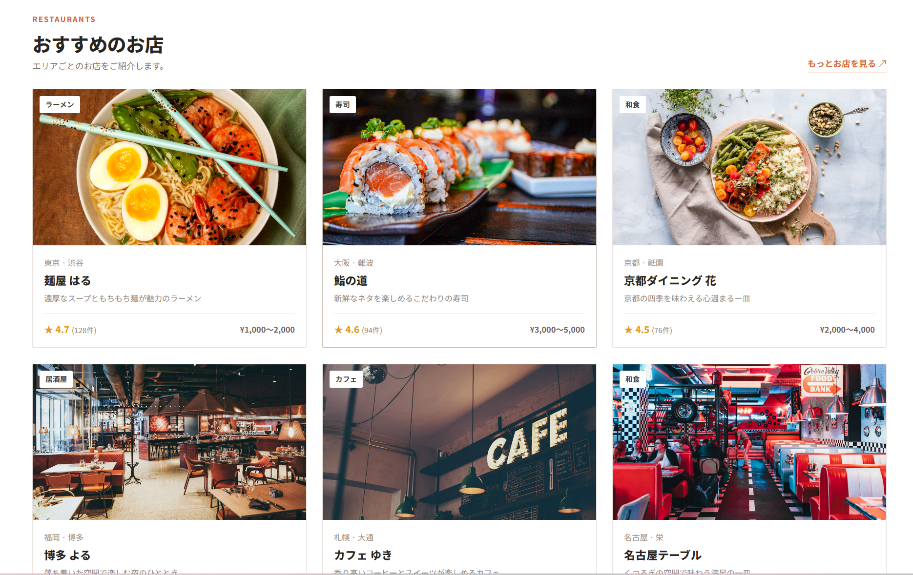
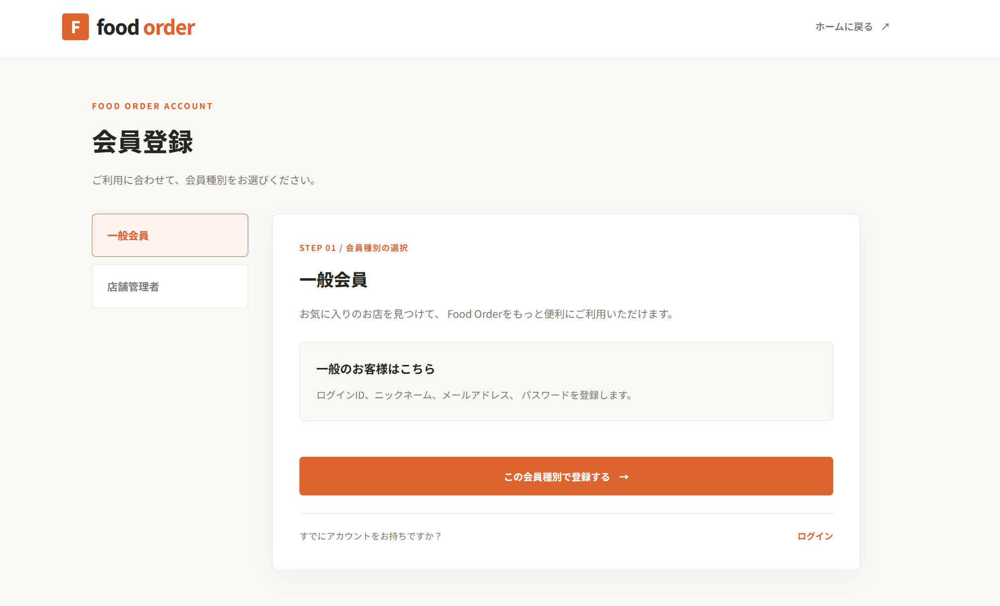
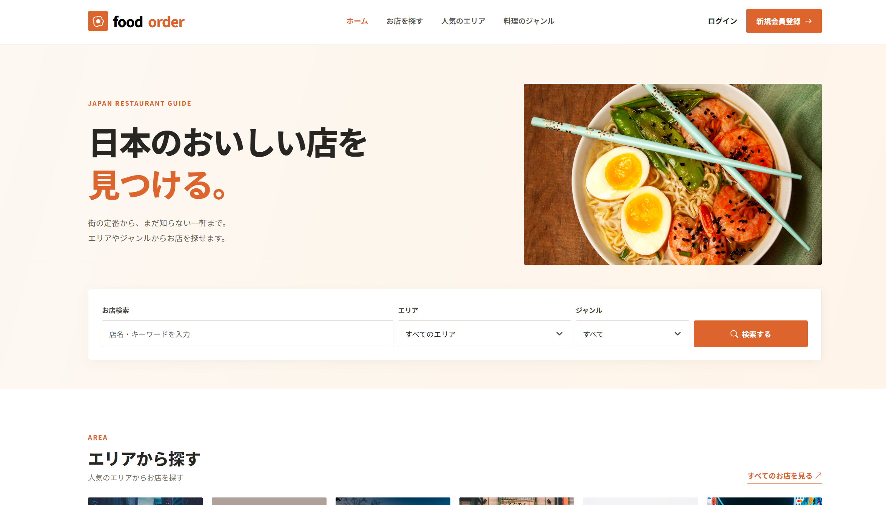

# 🍽️ Food Order

### 日本の飲食店をエリア・ジャンルから探せる飲食店検索Webサービス

 

## 📖 About

**Food Order**は、日本の飲食店を検索し、
店舗の詳細情報を確認できるWebサービスです。

店名・エリア・料理のジャンルから、
目的や好みに合ったお店を探すことができます。

一般会員・店舗管理者・運営管理者の役割に応じた機能を設け、
会員認証から管理者による会員管理まで実装しています。

現在、3名のチームで開発を進めています。

 

## 📅 Development Period

**2026.11.04 ～ 2026.11.30（予定）**

 

## ✨ Features

### 🔎 飲食店検索

店名・キーワード・エリア・料理のジャンルを組み合わせて、
飲食店を検索できます。

会員登録をしていないユーザーも、
店舗検索や詳細情報の閲覧を利用できます。

### 🏪 店舗詳細

店舗の住所・営業時間・定休日・予算・メニューなど、
お店選びに必要な情報を確認できます。

### 👤 会員登録・メール認証

一般会員と店舗管理者に分けた会員登録に対応しています。

メールで送信された認証コードを確認した後、
アカウント情報を登録する仕組みです。

店舗管理者は、店舗名・事業者情報なども登録します。

### 🔐 ログイン・アカウント連携

ログインIDまたはメールアドレスによるログインに対応しています。

一般会員は、登録済みのFood Orderアカウントに
Googleアカウントを連携することで、Googleログインを利用できます。

### ✉️ アカウント復旧

ログインIDの検索と、
メール認証によるパスワード再設定に対応しています。

### 🛡️ 管理者機能

管理者専用画面から会員の検索・利用停止・利用再開を行えます。

状態変更時には理由の入力を必須とし、
操作した管理者・対象会員・変更内容・日時を記録します。

 

## 🙋 My Contribution

**会員認証・アカウント管理・管理者機能を担当しました。**

### 会員登録

- 一般会員・店舗管理者の登録画面と登録処理
- メール認証コードの送信・確認
- ログインID・ニックネーム・メールアドレスの重複チェック
- 入力値の検証とエラーメッセージの表示
- パスワードのハッシュ化と表示切替

### ログイン・アカウント管理

- ログイン・ログアウト処理
- ログインIDまたはメールアドレスによる認証
- Googleアカウントの連携とログイン
- ログインID検索・パスワード再設定
- 一般会員・店舗管理者・管理者の権限別アクセス制御

### 管理者画面

- 管理者専用のダークテーマ画面
- 会員検索・会員種別と利用状態による絞り込み
- 会員の利用停止・利用再開
- 操作履歴の記録・閲覧
- 管理者のみ表示される管理画面への導線

 

## 🧩 Design & Implementation

### MVCパターン

Controllerでリクエストを受け付け、
Serviceで業務処理、Mapperでデータベース操作を行い、
Thymeleafで画面を表示する構成にしました。

### 認証・認可

Spring Securityを使用し、
ログイン状態と会員の権限に応じてアクセスを制御しました。

画面上の表示制御に加え、
サーバー側でも管理者機能へのアクセスを制限しています。

### トランザクション管理

会員の利用状態変更と操作履歴の保存を
同一トランザクションで処理するようにしました。

履歴の保存に失敗した場合は、
会員の状態変更もロールバックします。

 

## 🛠️ Tech Stack

| Category | Technology |
| :--- | :--- |
| **Language** | Java 21 |
| **Backend** | Spring Boot, Spring MVC, Spring Security |
| **Template Engine** | Thymeleaf |
| **Database Access** | MyBatis |
| **Frontend** | HTML, CSS, JavaScript, Bootstrap |
| **Database** | MySQL 8.4 |
| **Authentication** | OAuth 2.0 / OpenID Connect（Google） |
| **Mail** | Spring Mail, Gmail SMTP |
| **Build Tool** | Gradle |
| **Server** | Apache Tomcat（組み込み） |
| **IDE** | IntelliJ IDEA |
| **Version Control** | Git, GitHub |

 

## 🗄️ Database

MySQLを使用し、以下の情報を管理しています。

- 会員情報・権限・利用状態
- 店舗管理者の事業者情報
- Googleアカウントの連携情報
- 店舗・エリア・料理ジャンル情報
- 管理者の操作履歴

<!-- ER図は準備でき次第追加 -->

 

## 🚧 Development Status

**現在開発中のプロジェクトです。**

今後は、レビュー・評価機能や店舗管理機能の拡充、
画面間の連携確認、動作検証を進める予定です。

<!-- 実装状況に合わせて更新 -->

 

## 👥 Developers

| Name |
| :---: |
| ジョン・スンファン |
| ジョン・カンホ |
| キム・スリム |

 

## 📸 Screenshots

### 🏠 ホーム画面

エリア・料理のジャンル・キーワードから飲食店を検索できます。

 

### 👤 会員登録画面

一般会員と店舗管理者を選択し、メール認証後に会員登録を行います。

 

### 🍽️ 店舗一覧

店舗の写真・エリア・ジャンルなどを確認し、お店を探せます。

